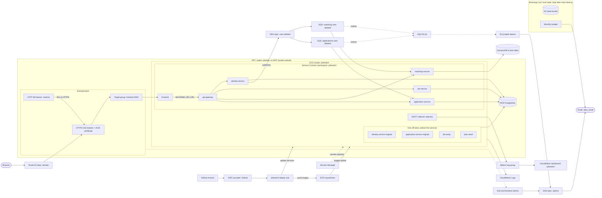

# Architecture: what Day 35 deploys

This drawing is read from the Terraform under [infra/terraform](../infra/terraform): one AWS region,
and the hosted zone for the domain is made outside Terraform, so it stays. The bootstrap root's state
bucket and monthly budget are kept after the main root's destroy, because the budget keeps watching.
A fix PR that changes the Terraform updates this file.

| Box | Declared in |
|---|---|
| Browser | outside Terraform: the user's browser |
| Route 53 alias: domain | [alb.tf](../infra/terraform/alb.tf) |
| ALB jobmatch | [alb.tf](../infra/terraform/alb.tf) |
| HTTPS 443 listener + ACM certificate | [alb.tf](../infra/terraform/alb.tf) |
| HTTP 80 listener: redirect | [alb.tf](../infra/terraform/alb.tf) |
| Target group: frontend 3000 | [alb.tf](../infra/terraform/alb.tf) |
| VPC: public subnets, no NAT; private subnets | [modules/network/main.tf](../infra/terraform/modules/network/main.tf) |
| ECS cluster: jobmatch | [ecs.tf](../infra/terraform/ecs.tf) |
| Service Connect namespace: jobmatch | [ecs.tf](../infra/terraform/ecs.tf) |
| frontend | [ecs.tf](../infra/terraform/ecs.tf), [modules/service/main.tf](../infra/terraform/modules/service/main.tf), [locals.tf](../infra/terraform/locals.tf) |
| api-gateway | [ecs.tf](../infra/terraform/ecs.tf), [modules/service/main.tf](../infra/terraform/modules/service/main.tf), [locals.tf](../infra/terraform/locals.tf) |
| identity-service | [ecs.tf](../infra/terraform/ecs.tf), [modules/service/main.tf](../infra/terraform/modules/service/main.tf), [locals.tf](../infra/terraform/locals.tf) |
| job-service | [ecs.tf](../infra/terraform/ecs.tf), [modules/service/main.tf](../infra/terraform/modules/service/main.tf), [locals.tf](../infra/terraform/locals.tf) |
| matching-service | [ecs.tf](../infra/terraform/ecs.tf), [modules/service/main.tf](../infra/terraform/modules/service/main.tf), [locals.tf](../infra/terraform/locals.tf) |
| application-service | [ecs.tf](../infra/terraform/ecs.tf), [modules/service/main.tf](../infra/terraform/modules/service/main.tf), [locals.tf](../infra/terraform/locals.tf) |
| One-off tasks, before the services | [ecs.tf](../infra/terraform/ecs.tf), [modules/task/main.tf](../infra/terraform/modules/task/main.tf), [locals.tf](../infra/terraform/locals.tf) |
| identity-service-migrate | [ecs.tf](../infra/terraform/ecs.tf), [modules/task/main.tf](../infra/terraform/modules/task/main.tf), [locals.tf](../infra/terraform/locals.tf) |
| application-service-migrate | [ecs.tf](../infra/terraform/ecs.tf), [modules/task/main.tf](../infra/terraform/modules/task/main.tf), [locals.tf](../infra/terraform/locals.tf) |
| db-setup | [ecs.tf](../infra/terraform/ecs.tf), [modules/task/main.tf](../infra/terraform/modules/task/main.tf), [locals.tf](../infra/terraform/locals.tf) |
| jobs-seed | [ecs.tf](../infra/terraform/ecs.tf), [modules/task/main.tf](../infra/terraform/modules/task/main.tf), [locals.tf](../infra/terraform/locals.tf) |
| ADOT collector sidecars | [collector.tf](../infra/terraform/collector.tf) |
| RDS PostgreSQL | [modules/database/main.tf](../infra/terraform/modules/database/main.tf) |
| DynamoDB scores table | [modules/scores/main.tf](../infra/terraform/modules/scores/main.tf) |
| SNS topic: user-deleted | [modules/bus/main.tf](../infra/terraform/modules/bus/main.tf) |
| SQS: matching-user-deleted | [modules/bus/main.tf](../infra/terraform/modules/bus/main.tf) |
| SQS: applications-user-deleted | [modules/bus/main.tf](../infra/terraform/modules/bus/main.tf) |
| SQS DLQs | [modules/bus/main.tf](../infra/terraform/modules/bus/main.tf) |
| Secrets Manager | [secrets.tf](../infra/terraform/secrets.tf) |
| ECR repositories | [ecr.tf](../infra/terraform/ecr.tf) |
| CloudWatch Logs | [modules/service/main.tf](../infra/terraform/modules/service/main.tf), [modules/task/main.tf](../infra/terraform/modules/task/main.tf) |
| Metrics log group | [collector.tf](../infra/terraform/collector.tf) |
| CloudWatch dashboard: jobmatch | [dashboard.tf](../infra/terraform/dashboard.tf) |
| ALB and frontend alarms | [alarms.tf](../infra/terraform/alarms.tf) |
| DLQ depth alarms | [modules/bus/main.tf](../infra/terraform/modules/bus/main.tf) |
| SNS topic: alarms | [modules/bus/main.tf](../infra/terraform/modules/bus/main.tf) |
| Email: alert_email | [modules/bus/main.tf](../infra/terraform/modules/bus/main.tf), [bootstrap/main.tf](../infra/terraform/bootstrap/main.tf) |
| GitHub Actions | outside Terraform: the [workflows](../.github/workflows/) |
| OIDC provider: GitHub | [deploy.tf](../infra/terraform/deploy.tf) |
| jobmatch-deploy role | [deploy.tf](../infra/terraform/deploy.tf) |
| Bootstrap root: local state, kept after main destroy | [bootstrap/main.tf](../infra/terraform/bootstrap/main.tf) |
| S3 state bucket | [bootstrap/main.tf](../infra/terraform/bootstrap/main.tf) |
| Monthly budget | [bootstrap/main.tf](../infra/terraform/bootstrap/main.tf) |

## Not drawn

- The calls between the backends, other than the gateway's four URLs: each service's `*_URL` and key-set
  URLs in [locals.tf](../infra/terraform/locals.tf).
- The deploy role's `ecs:RunTask` on the two migrate tasks, and the scopes of its other statements
  ([deploy.tf](../infra/terraform/deploy.tf)).
- The RDS-managed master secret that `db-setup` reads, and the DNS records that validate the certificate.
- The metric sources of the dashboard (ALB, ECS, SQS and the JobMatch namespace): read, not drawn as edges.
- The security group rules: the VPC box names the groups; their rules are in
  [modules/network/main.tf](../infra/terraform/modules/network/main.tf).
- The `localstack` directory: a stand-in for the main root that only infra-ci runs.
